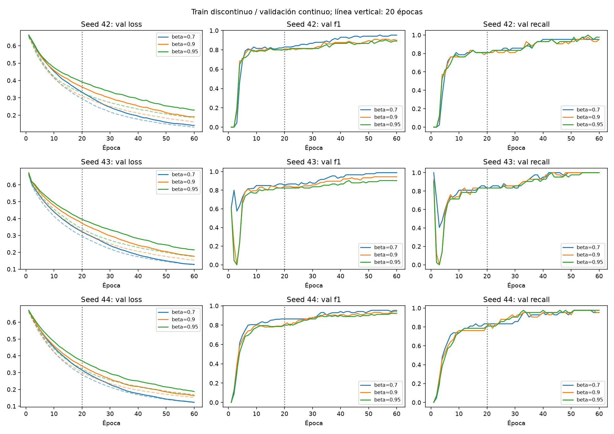
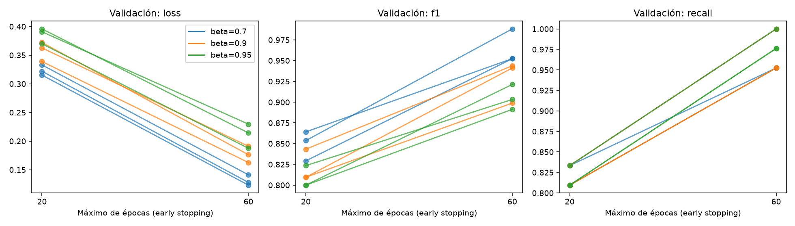
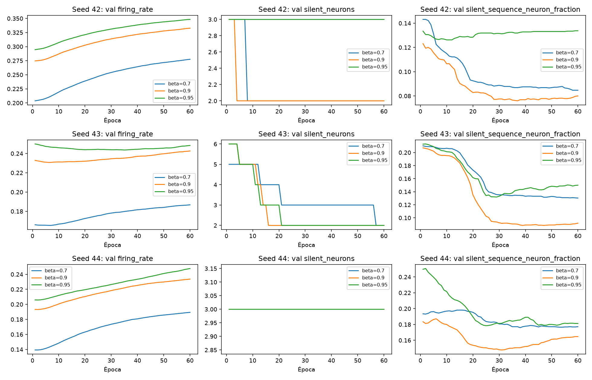

# ECG5000: duración de entrenamiento y beta (solo train/validación)

Investigación exploratoria del 5 de noviembre de 2026. **El baseline original se conserva.**

## Hipótesis y protocolo

1. Veinte épocas podrían dejar el modelo sin terminar de aprender: comparar el mejor checkpoint de las primeras 20 con el mejor hasta 60.
2. Cambiar beta modifica la retención de membrana y puede cambiar discriminación y actividad; una retención mayor no garantiza mejor clasificación.
3. La inicialización y el orden de batches podrían explicar parte de las diferencias: repetir tres semillas emparejadas.

Protocolo fijado antes de comparar: beta 0.7/0.9/0.95 × semillas 42/43/44, nueve entrenamientos desde cero. Mismos 400 ejemplos de train y 100 de validación (split seed 42; normal/resto: train 234/166, val 58/42). Las semillas varían pesos y orden de batches, no el split. Entre betas, cada semilla comparte inicialización y orden de batches.

Arquitectura y optimización: 32 LIF, siete ventanas de 20 puntos, umbral 1, reset retardado, surrogate fast sigmoid slope 25, Adam lr=0.001, batch 64; sin ponderación de clases ni ajuste del umbral de clasificación. CPU, un hilo y algoritmos deterministas. Versiones, índices, escalado y checksum en [protocol.json](protocol.json).

Presupuesto máximo 60 épocas; early stopping exclusivamente por pérdida de validación, paciencia 10, min_delta=0.0001 y mínimo 20 épocas. La paciencia se reinicia solo ante una mejora superior a min_delta; el checkpoint conserva cualquier mínimo estricto de val loss. F1/recall/actividad no intervienen en la parada ni en la selección.

El cargador nuevo solo deserializa `ECG5000_TRAIN.txt`; calcula el checksum del ZIP completo pero no abre el miembro TEST. La normalización se ajusta solo al train derivado. No se llamó al entrenamiento baseline que evalúa test al finalizar.

Los horizontes de 20 y 60 se comparan dentro de la misma trayectoria de entrenamiento de cada pareja beta/semilla: no se reinicializa el modelo en la época 20. La arquitectura, optimizador, datos y umbral de clasificación se mantienen constantes. El control beta=0.9/seed=42 reproduce el baseline en la época 20.

## Resultados reales de validación

Cada celda muestra **media ± desviación estándar muestral** entre tres semillas; no es un intervalo de confianza. Las métricas pertenecen al checkpoint elegido por pérdida, no al máximo independiente de cada métrica.

| Beta | Loss ≤20 | Loss ≤60 | F1 ≤20 | F1 ≤60 | Recall ≤20 | Recall ≤60 |
|---|---:|---:|---:|---:|---:|---:|
| 0.7 | 0.3234 ± 0.0090 | 0.1307 ± 0.0093 | 0.8490 ± 0.0179 | 0.9643 ± 0.0207 | 0.8254 ± 0.0137 | 0.9683 ± 0.0275 |
| 0.9 | 0.3579 ± 0.0171 | 0.1766 ± 0.0142 | 0.8208 ± 0.0195 | 0.9280 ± 0.0252 | 0.8175 ± 0.0137 | 0.9683 ± 0.0275 |
| 0.95 | 0.3855 ± 0.0138 | 0.2105 ± 0.0213 | 0.8078 ± 0.0136 | 0.9053 ± 0.0151 | 0.8175 ± 0.0137 | 0.9841 ± 0.0137 |

**Las nueve ejecuciones llegaron a 60 épocas; en todas el mínimo de pérdida fue la época 60.** No se activó la paciencia del early stopping. El límite de 60, no una meseta detectada, determinó la duración; no se ha localizado un número óptimo de épocas.

| Beta | Semilla | Mejor época ≤20 / ≤60 | Loss ≤20 → ≤60 | F1 ≤20 → ≤60 | Recall ≤20 → ≤60 |
|---|---:|---:|---:|---:|---:|
| 0.7 | 42 | 20 / 60 | 0.3330 → 0.1412 | 0.8293 → 0.9524 | 0.8095 → 0.9524 |
| 0.7 | 43 | 20 / 60 | 0.3219 → 0.1279 | 0.8537 → 0.9882 | 0.8333 → 1.0000 |
| 0.7 | 44 | 20 / 60 | 0.3153 → 0.1232 | 0.8642 → 0.9524 | 0.8333 → 0.9524 |
| 0.9 | 42 | 20 / 60 | 0.3627 → 0.1911 | 0.8095 → 0.8989 | 0.8095 → 0.9524 |
| 0.9 | 43 | 20 / 60 | 0.3722 → 0.1762 | 0.8434 → 0.9438 | 0.8333 → 1.0000 |
| 0.9 | 44 | 20 / 60 | 0.3390 → 0.1626 | 0.8095 → 0.9412 | 0.8095 → 0.9524 |
| 0.95 | 42 | 20 / 60 | 0.3908 → 0.2296 | 0.8000 → 0.8913 | 0.8095 → 0.9762 |
| 0.95 | 43 | 20 / 60 | 0.3959 → 0.2143 | 0.8235 → 0.9032 | 0.8333 → 1.0000 |
| 0.95 | 44 | 20 / 60 | 0.3699 → 0.1875 | 0.8000 → 0.9213 | 0.8095 → 0.9762 |

Control de continuidad: beta=0.9, seed=42, época 20 reprodujo **exactamente** los pesos, índices, normalización y pérdida de validación del checkpoint baseline existente. Su loss pasó de 0.362699 a 0.191052, F1 de 0.809524 a 0.898876 y recall de 0.809524 a 0.952381 al continuar hasta 60. Se compararon pesos y validación, sin reevaluar test.

### Interpretación de loss, F1, recall y precision

La **loss** es cross entropy: evalúa las puntuaciones asignadas a las etiquetas, no solo el número de aciertos. Una menor pérdida puede no cambiar argmax ni F1. **Recall** = TP/(TP+FN) mide qué fracción de «resto» se recupera; **precision** = TP/(TP+FP) mide qué fracción de las predicciones «resto» acierta. **F1** es su media armónica. La clase positiva es «resto», y las matrices en JSON usan filas reales/columnas predichas en orden `[normal, resto]`.

En los checkpoints seleccionados hasta 60 épocas, las precision de validación derivadas de los resultados ya guardados son:

| Beta | Precision media ± SD | Falsos positivos por semilla 42 / 43 / 44 |
|---|---:|---:|
| 0.7 | 0.9605 ± 0.0141 | 2 / 1 / 2 |
| 0.9 | 0.8916 ± 0.0396 | 7 / 5 / 3 |
| 0.95 | 0.8386 ± 0.0293 | 9 / 9 / 6 |

Beta=0.95 pierde menos positivos, pero clasifica más latidos normales como «resto». Eso explica su mayor recall y menor precision/F1 respecto a beta=0.7. Ni estos valores ni la cross entropy equivalen a una validación clínica. La selección sigue siendo por pérdida: no se eligieron épocas distintas para mejorar cada métrica.



En el panel de pérdida, train es discontinuo y validación continuo, ambos medidos al terminar cada época. La línea vertical señala 20 épocas. F1 y recall son de validación; sus oscilaciones no modifican la selección por pérdida. El historial conserva además la pérdida online acumulada durante las actualizaciones para compararla con el log original.



Cada segmento conecta los dos horizontes de la misma semilla y beta. El gráfico compara presupuestos de selección; no presupone que otra ejecución active early stopping en la época 60.

## Actividad LIF en el checkpoint seleccionado

Tasa = spikes / (latidos × 140 pasos × 32 neuronas), una proporción por paso, **no Hz**. Silenciosa = cero spikes en todo el split. La fracción latido/neurona silenciosa cuenta pares sin spikes aunque la neurona dispare en otros latidos. Las tres medidas se guardan para train y validación en cada época, incluidas 32 tasas individuales.

| Beta | Semilla | Tasa train | Tasa val | Silenciosas train / val (de 32) | Pares silenciosos val |
|---|---:|---:|---:|---:|---:|
| 0.7 | 42 | 0.2787 | 0.2774 | 2 / 2 | 8.47 % |
| 0.7 | 43 | 0.1869 | 0.1868 | 2 / 2 | 13.03 % |
| 0.7 | 44 | 0.1895 | 0.1894 | 3 / 3 | 17.72 % |
| 0.9 | 42 | 0.3339 | 0.3326 | 2 / 2 | 8.00 % |
| 0.9 | 43 | 0.2432 | 0.2426 | 2 / 2 | 9.19 % |
| 0.9 | 44 | 0.2340 | 0.2336 | 3 / 3 | 16.47 % |
| 0.95 | 42 | 0.3493 | 0.3483 | 3 / 3 | 13.38 % |
| 0.95 | 43 | 0.2492 | 0.2484 | 3 / 2 | 15.00 % |
| 0.95 | 44 | 0.2479 | 0.2477 | 3 / 3 | 18.12 % |



Beta=0.7 tiene una tasa media de validación menor en cada semilla emparejada, pero el mayor F1 en este barrido. El número de neuronas silenciosas seleccionado es 2–3 sobre 32: no se observa colapso de toda la capa. La variación de actividad entre semillas es considerable; una media global de spikes por sí sola no diagnostica la calidad de la representación. Una neurona silenciosa en este split no queda demostrada como permanentemente inactiva en otros datos.

**Observación frente a explicación:** las curvas muestran mayor actividad al aumentar beta en cada semilla y mejor discriminación con beta=0.7. Una posible explicación es que menor retención reduzca la mezcla temporal entre partes del latido. No se ha aislado ese mecanismo: los pesos aprendidos también cambian, y no se hicieron ablaciones adicionales. El número de neuronas silenciosas tampoco demuestra por sí solo por qué cambia F1.

## Conclusiones y límites

- **Veinte épocas eran insuficientes en esta validación:** las nueve parejas mejoran loss, F1 y recall al ampliar hasta 60. Las curvas siguen descendiendo; no prueban convergencia ni garantizan que seguir entrenando indefinidamente ayude.
- **Beta=0.7 es el candidato exploratorio por pérdida de validación:** logra menor loss y mayor F1 en las tres semillas frente a 0.9/0.95. No se cambia el baseline ni se declara una mejora de test.
- **Hay un compromiso con recall:** beta=0.95 obtiene recall medio 0.9841 frente a 0.9683 de 0.7/0.9, pero más falsos positivos (6–9 por semilla frente a 1–2 con 0.7), reduciendo precision y F1. No existe un ganador universal para todos los criterios.
- No hay divergencia evidente de loss train/val hasta 60 en estas curvas, pero no es prueba de ausencia de sobreajuste. Con solo 100 ejemplos de validación (42 positivos), un caso cambia recall en 1/42 ≈ 0.0238. Tres semillas sobre el mismo split no equivalen a validación cruzada ni son tres cohortes independientes.
- El test oficial **ya se observó durante el desarrollo inicial**. Este barrido no vuelve a evaluarlo, pero eso no restaura su independencia. La selección repetida sobre la misma validación también puede sobreajustarla. Estos resultados son exploratorios y no una evaluación confirmatoria.
- ECG5000 procede de un solo paciente y etiquetas automáticas; no demuestra generalización entre pacientes ni eficacia clínica. Las tasas de disparo no son medidas de energía, latencia ni FPGA.

Trabajo futuro: conservar beta=0.7 como candidato, discutir el criterio loss/F1 frente a recall y acordar una validación adicional antes de sustituir nada. No se han ampliado épocas, cambiado splits ni consultado test para perseguir más mejoras.

## Artefactos y reproducción

```bash
uv sync --frozen --group dev
uv run pytest -q
uv run python -m spiking_ecg.research \
  --seeds 42 43 44 --max-epochs 60 --patience 10 \
  --output results/research-beta-repeat --report-dir reports/research-beta-repeat
```

[comparison.csv](comparison.csv): tabla por ejecución; [aggregate.json](aggregate.json): medias y SD; [runs.json](runs.json): métricas de checkpoints seleccionados; [histories.json](histories.json): métricas y actividad por época; [protocol.json](protocol.json): protocolo y entorno. Checkpoints nuevos y logs locales en `results/research-beta/`, fuera de Git por la regla existente.

Tiempo medido: 168.36 s sumando las nueve ejecuciones (incluye diagnósticos por época; no es un benchmark). Durante la investigación original, las **22 pruebas pasaron** (`22 passed in 12.51s`), incluidas protección del test, parada por loss aunque F1 mejore, conteo de actividad y guardado del checkpoint. Se inspeccionaron las gráficas.

Se recargaron los nueve `best.pt` y se repitieron exclusivamente sus medidas de validación: métricas y actividad coincidieron exactamente con los resúmenes guardados.

El módulo nuevo es `src/spiking_ecg/research.py`; las pruebas nuevas están en `tests/test_research.py`. Durante la investigación se conservaron modelos, entrenamiento baseline, dependencias y artefactos previos; 100 archivos existentes de resultados/informes se comprobaron mediante SHA-256 frente a la versión de partida `c936495`.

El cierre publica esta investigación existente, con documentación revisada y sin nuevos experimentos ni cambios en CSV, JSON o figuras. La revisión para publicación se documenta en [VERIFICATION.md](VERIFICATION.md). Volver al [README principal](../../README.md) o al [informe original del baseline](../README.md).
